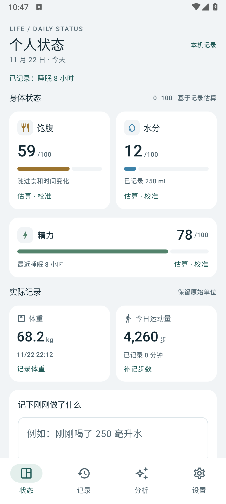

# 个人状态 · Android 原型

给自己使用的生活游戏化 App，版本 0.1.0。界面采用已确认的紧凑仪表盘，目标真机是一加 Ace 3。


## 安装测试版

在手机浏览器打开 [GitHub Releases](https://github.com/RedPPPanda/lifestyle/releases)，下载最新版本 Assets 中的 `LifeStatus-0.1.0-debug.apk` 并安装。当前提供 debug 签名的个人测试版，最低支持 Android 8.0。

首次启动可以先不配置 AI，输入“刚刚喝了250毫升水”测试本地记录和状态更新；记录支持撤销，关闭并重新打开后会保留数据。API 密钥请直接在手机的设置页填写。

首页预览使用模拟器测试数据，首次安装不会预填这些数值。



## 本轮需求

- 饱腹、水分、精力采用 0–100 状态条，精力与困倦合并。
- 保留实际记录单位：饮水 mL、睡眠小时、体重 kg、步数和运动分钟。
- 状态按行为和经过时间计算；关闭后重新打开也按记录时间重算。
- 文字、语音、食物照片和健康数据截图都可以作为记录入口。
- AI 解析后自动更新；支持校准、整组撤销与删除。
- 手机计步读取系统传感器；健康 App 截图可以补充今天总步数等数据。
- 记录和状态变化触发综合分析，允许选择参与分析的数据范围和最短间隔。
- 文字解析、图片识别、综合分析支持三套独立的兼容接口配置。图片或分析接口留空时沿用主接口。
- 首选 DeepSeek，保留自定义服务地址和模型。心情、压力、任务、等级等留待后续版本。

## 使用

首次启动不填入演示身体数据。可以先点击状态卡进行校准，或输入“刚刚喝了250毫升水”“刚刚睡了8小时”等记录。无 AI 配置时，常见文字由本地规则识别；不能可靠理解的内容只保存为备注。

设置中的 DeepSeek 预设会填写 `https://api.deepseek.com` 和 `deepseek-flash`，密钥请直接在手机上填写。保存连接后，提交的新文字会发送给所选服务解析。图片先附加，点击记录后才上传；可以补充文字说明、移除图片，或在失败记录中重试。

语音优先使用设备识别服务。系统服务不可用且主接口为 DeepSeek 时，采用其云端语音接口：点击语音开始，再次点击结束，最长60秒。音频不进入长期分析或导出。系统识别能力、麦克风效果仍需一加真机验证。

综合分析的数据范围独立于本次输入解析：关闭某类历史数据的综合分析，不会阻止你主动提交的新文字或图片发送给解析模型。默认不发送历史原文。分析页可以查看按当前范围生成的发送数据。

## 数值含义

饱腹、水分、精力是可校准的游戏估算值。默认衰减和增益是本轮可调整的起始规则，尚未作为经过验证的人体平均模型。体重等测量记录保持原始单位。规则页允许调整各项速度和增益。

睡眠按时间区间恢复精力，避免在同一段睡眠中同时进行清醒衰减。历史补记、删除与撤销会重新回放记录。跨日按手机当地时间统计。

计步从本 App 启用系统计步时建立基线，标明覆盖范围，不把开机以来的累计传感器值当作今天全天步数。截图里的“今天总步数”作为绝对观测，不与已有来源简单相加。开启系统计步后，文字描述的步数增量保留为备注，避免与同一段传感器活动重复；仍可记录运动时长或校准今天总步数。

## 数据与后台运行

原文先写入本机，再由持久化任务解析。离开页面、重建 Activity 不会丢掉已提交的文字；撤销待解析记录后，晚到的 AI 结果也不会恢复它。

记录使用应用私有存储和原子更新，密钥使用 Android Keystore 加密，关闭系统备份。导出 JSON 包含记录、删除标记和计算规则，不包含密钥、音频或原始图片。图片副本保存在应用私有目录，删除或撤销对应记录时清理。

系统计步需要运动权限和前台通知。手机重启后需先打开一次 App 恢复计步。综合分析使用 WorkManager：短时连续变化合并，默认最短间隔30分钟，失败请求也遵守间隔。后台调度会受到安卓省电策略影响，并不保证固定秒数执行。

## 构建

环境：JDK 17，Gradle 8.13，Android SDK 36，Build Tools 35.0.0。最低 Android 8.0，目标 API 35。源代码为 Kotlin + Jetpack Compose。

用 Android Studio 打开本目录，设置 SDK 路径；或设置 `JAVA_HOME`、`ANDROID_HOME` 后执行：

```powershell
.\gradlew.bat :app:assembleDebug :app:testDebugUnitTest :app:lintDebug
```

首次构建会下载依赖。APK 位于 `app/build/outputs/apk/debug/app-debug.apk`。

## 模块

- `core/`：事件模型、时间回放、基础文字识别。
- `data/`：本机记录、接口配置与数据范围过滤。
- `ai/`：兼容接口客户端、独立版本提示模板、图片及 DeepSeek 语音协议。
- `platform/`：麦克风与系统计步。
- `ui/`：仪表盘、记录、分析与设置。
- `RecordCoordinator.kt`：先保存再解析，支持图片失败重试。
- `AutoAnalysis.kt`：自动分析调度与失败冷却。

## 验证范围

APK构建、29项核心单元测试和Android lint已通过。另有21组AI／图片／语音协议检查和17组存储检查通过。安卓9独立测试实例已验收记录、衰减、校准、撤销、保存、图片入口、配置、数据预览与JSON导出。详见VALIDATION.json。真实计步、ColorOS后台、麦克风和真实付费AI服务仍待一加Ace 3真机验收。

## 接口资料

- [DeepSeek 当前接口及模型](https://api-docs.deepseek.com/zh-cn/)
- [DeepSeek 图片输入](https://api-docs.deepseek.com/guides/vision/)
- [DeepSeek 语音转文字](https://api-docs.deepseek.com/guides/asr/)
- [Android 计步传感器](https://developer.android.com/develop/sensors-and-location/sensors/sensors_motion)
- [Android 无线调试](https://developer.android.com/tools/adb)

手机“健康”App的历史数据库尚未通过厂商接口直接接入；第一轮支持系统计步与用户主动提交的健康截图。真机阶段核实 ColorOS 的后台行为、健康数据开放能力和实际语音效果。
